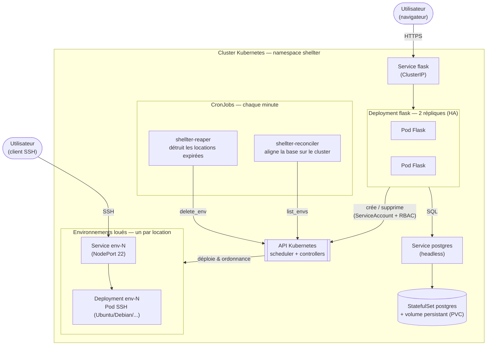

# Schéma d'architecture — branche Kubernetes

Vue simplifiée de l'architecture de Shellter sur Kubernetes. L'application Flask ne
lance plus les conteneurs elle-même : elle pilote l'**API Kubernetes**, qui crée un
Deployment + un Service NodePort pour **chaque location**.

## Légende rapide
- **Deployment flask (2 répliques)** → haute disponibilité du plan de contrôle.
- **StatefulSet postgres + PVC** → données durables (survit au redémarrage du Pod).
- **env-N** (Deployment + Service NodePort) → une instance louée = un déploiement à part entière, créé à la volée via l'API.
- **ServiceAccount + RBAC** → Flask n'a le droit de gérer que les Deployments/Services du namespace `shellter`.
- **CronJobs** → `reaper` (expiration) et `reconciler` (cohérence base ↔ cluster), relancés chaque minute.

## Correspondance avec la version « maison » (branche `main`)
| Brique `main` | Équivalent Kubernetes |
|---|---|
| Worker Agent + Resource Manager | API Kubernetes + scheduler |
| Heartbeat + reprise sur panne codés | self-healing & reschedule natifs |
| Worker d'expiration en boucle | CronJob `shellter-reaper` |
| docker-compose | Deployment / StatefulSet / Service |
